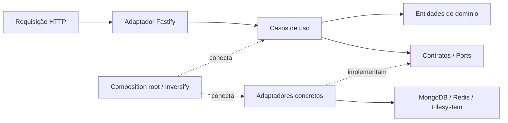

# WYD Backend Clean

API REST em TypeScript para um backend de WYD, organizada em **Ports and Adapters**, com casos de uso separados do transporte HTTP e da persistência.

**English:** A TypeScript REST API for a WYD backend, exploring hexagonal architecture with Fastify, MongoDB, Redis and dependency injection.

[Primeiros passos](#primeiros-passos) · [Exemplos](#exemplos-http) · [Arquitetura](#arquitetura) · [Contribuir](CONTRIBUTING.md)

## O que você encontra aqui

- Cadastro de usuários e autenticação com bcrypt e JWT.
- Criação, atualização, listagem e remoção de posts.
- Criação e remoção de produtos.
- Validação de entrada com schemas do Fastify e Zod.
- Repositórios MongoDB, cache Redis e armazenamento local de arquivos.
- Contratos para trocar implementações de persistência, criptografia e storage.

O domínio também contém entidades de jogadores, guildas e pedidos; isso **não** significa que todas tenham endpoints publicados. As rotas disponíveis estão listadas abaixo.

> **Estado do projeto:** implementação de estudo, com limitações conhecidas. Os middlewares de autenticação e autorização existentes não estão conectados às rotas atuais. Não exponha esta API na internet sem revisar segurança e dependências.

## Arquitetura



| Diretório | Responsabilidade |
| --- | --- |
| [`src/core/domain/entities`](src/core/domain/entities) | Entidades do domínio |
| [`src/core/usecases`](src/core/usecases) | Fluxos da aplicação |
| [`src/core/validators`](src/core/validators) | Validação de entradas |
| [`src/ports`](src/ports) | Contratos consumidos pelos casos de uso |
| [`src/adapters`](src/adapters) | HTTP, banco, cache, criptografia e arquivos |
| [`src/data/mongo/models`](src/data/mongo/models) | Schemas Mongoose |
| [`src/main`](src/main) | Inicialização, rotas e configuração da injeção de dependências |

A composição das implementações fica em [`src/main/setup.ts`](src/main/setup.ts). Para acompanhar um fluxo completo, comece por `POST /signup` em [`routes.ts`](src/main/routes.ts), siga para [`CreateUserUseCase`](src/core/usecases/create-user.ts) e depois para os contratos de repositório e criptografia.

## Primeiros passos

### 1. Instale as dependências

Você precisa de Node.js e npm, além de MongoDB e Redis acessíveis localmente. Docker é opcional para executar esses dois serviços.

```bash
git clone https://github.com/gabrielbsx/wyd-backend-clean.git
cd wyd-backend-clean
npm ci
cp .env.example .env
```

### 2. Configure o ambiente

Preencha pelo menos estas variáveis no `.env`:

```dotenv
MONGO_URI="mongodb://127.0.0.1:27027/wyd"
REDIS_URI="redis://127.0.0.1:6387"
JWT_SECRET="substitua-por-um-segredo-local-aleatorio"
UPLOAD_FOLDER="uploads"
```

Gere um segredo local com:

```bash
node -e "console.log(require('node:crypto').randomBytes(32).toString('hex'))"
```

Não publique seu `.env`. `MONGO_URI` precisa estar preenchida: o fallback atual de MongoDB em memória falha na inicialização.

Se não tiver os serviços instalados, execute em terminais separados:

```bash
docker run --rm --name wyd-mongo -p 127.0.0.1:27027:27017 mongo:7
```

```bash
docker run --rm --name wyd-redis -p 127.0.0.1:6387:6379 redis:7-alpine
```

Esses containers são descartáveis e não têm volumes persistentes: os dados são perdidos ao encerrá-los. As portas ficam limitadas à interface local.

As variáveis `MINIO_*` do [arquivo de exemplo](.env.example) pertencem ao adaptador alternativo de MinIO. A composição atual usa filesystem, portanto MinIO não é necessário para os exemplos de cadastro, login e listagem.

### 3. Inicie a API

```bash
npm run start:dev
```

O servidor usa a porta **3001**, definida em [`src/main/server.ts`](src/main/server.ts). Alterar uma variável `PORT` não muda essa configuração.

## Exemplos HTTP

Execute somente no seu ambiente local de desenvolvimento. O cadastro abaixo grava um usuário no MongoDB; repetir o mesmo cadastro retorna erro de usuário existente.

### Cadastrar um usuário

```bash
curl --fail-with-body -i http://localhost:3001/signup \
  -H 'Content-Type: application/json' \
  -d '{"username":"demo1234","email":"demo@example.com","password":"Demo1234","passwordConfirmation":"Demo1234"}'
```

### Autenticar

```bash
curl --fail-with-body -i http://localhost:3001/signin \
  -H 'Content-Type: application/json' \
  -d '{"username":"demo1234","password":"Demo1234"}'
```

O login retorna `token` e `user`. As credenciais acima são apenas demonstrativas. A validação atual aceita usuário e senha com 4 a 12 caracteres alfanuméricos.

### Listar posts

```bash
curl --fail-with-body -i 'http://localhost:3001/posts?page=1&limit=5'
```

### Rotas registradas

| Método | Rota | Operação |
| --- | --- | --- |
| POST | `/signup` | Cadastrar usuário |
| POST | `/signin` | Autenticar usuário |
| POST | `/posts` | Criar post com thumbnail |
| GET | `/posts` | Listar posts com paginação e filtros |
| PUT | `/posts/:id` | Atualizar post |
| DELETE | `/posts/:id` | Remover post |
| POST | `/products` | Criar produto com thumbnail |
| DELETE | `/products/:id` | Remover produto |

Fonte: [`src/main/routes.ts`](src/main/routes.ts). Posts e produtos com arquivos usam `multipart/form-data`; os campos estão nos [schemas](src/core/validators/schemas) e [validadores](src/core/validators/zod).

## Build e limitações conhecidas

```bash
npm run build
```

Validação local em **14/11/2026**, com Node.js **24.16.0**, npm **11.13.0**, MongoDB **7** e Redis **7**, em bases descartáveis:

| Verificação | Resultado |
| --- | --- |
| `npm ci` | Concluído, com avisos de dependências legadas |
| `npm run build` | Concluído |
| `POST /signup` com o exemplo acima | HTTP 201, sem senha na resposta |
| `POST /signin` com o usuário criado | HTTP 200, com token JWT e usuário sem senha |
| `GET /posts?page=1&limit=5` | HTTP 200, com uma lista |
| `npx tsc --noEmit` | Falha na referência de arquivo ausente descrita abaixo |

- O build usa tsup e gera arquivos em `dist/`; ele não substitui a checagem de tipos.
- Não existe script `npm test` nem suíte de testes versionada neste repositório.
- `npx tsc --noEmit` falha atualmente porque `tsconfig.json` referencia `src/@types/graphql.d.ts`, ausente no repositório.
- Há dependências legadas. Em Node.js 24.16.0, a instalação avisa que MinIO 7 declara suporte somente até Node.js 18; não interprete um build bem-sucedido como compatibilidade completa ou prontidão para produção.
- O storage local resolve caminhos a partir de `src/adapters/storage` no modo de desenvolvimento e não cria diretórios automaticamente. Com `UPLOAD_FOLDER="uploads"`, prepare-os antes de testar uploads:

  ```bash
  mkdir -p src/adapters/storage/uploads/posts src/adapters/storage/uploads/products
  ```

  Não versione os arquivos enviados. O `.gitignore` atual ignora `uploads/*` na raiz, não os diretórios aninhados acima.

## Como contribuir

Leia o [guia de contribuição](CONTRIBUTING.md). Correções reproduzíveis, testes e melhorias de documentação são bem-vindos.

Se este código ajudar você a estudar arquitetura hexagonal, uma estrela ajuda outras pessoas a encontrá-lo. Compartilhe o projeto junto de um exemplo do que você aprendeu ou construiu com ele.
